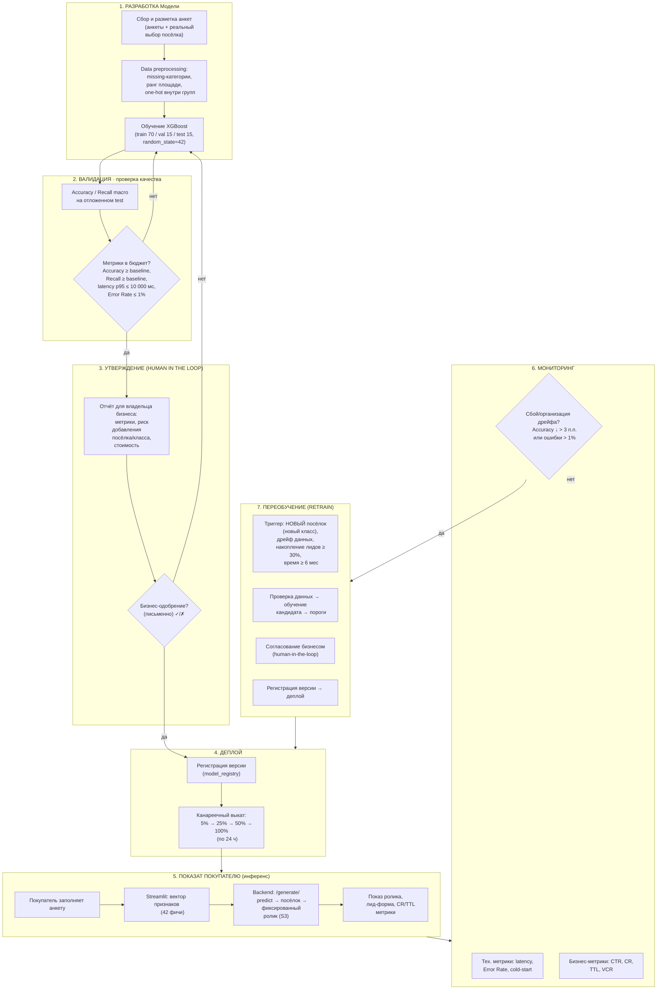

# BPMN: место модели в бизнес-процессе (согласование модели с бизнесом)

Схема показывает полный бизнес-контур модели классификации посёлка
(`global_best_model.joblib`), встроенной в сервис каталога видеобъектов
KASKAD. Видео **фиксированное по посёлку** (вариант A) — модель отвечает за
«какой посёлок показать», а не за содержимое роликов.

## 1. BPMN-диаграмма

## 2. Пояснение к каждому этапу

| Этап | Что происходит | Результат для следующего шага |
|---|---|---|
| **1. Разработка** | Сбор анкет + фактического выбора посёлка; preprocessing (missing / ранг площади / one-hot); обучение XGBoost | обученная модель-кандидат |
| **2. Валидация** | Проверка порогов: Accuracy ≥ baseline; Recall macro ≥ baseline; latency p95 ≤ 10 000 мс; Error Rate ≤ 1% | решение «в бюджет / не в бюджет» |
| **3. Утверждение** (human-in-the-loop) | Отчёт бизнесу; письменное одобрение | разрешение или отказ (фиксируется письменно) |
| **4. Деплой** | Регистрация `model_versions/model_vN.joblib`; канареечный выкат 5%→25%→50%→100% (24 ч на шаг) | модель получает 100% трафика или мгновенный rollback |
| **5. Инференс (продакшн)** | Анкета → вектор → predict → **фиксированный ролик посёлка** → лид-форма | лида и техметрики |
| **6. Мониторинг** | Техметрики + бизнесметрики; порог счёта: Accuracy падения > 3 п.п. или Error Rate > 1% → инцидент | решение «в порядке / в переобучение» |
| **7. Переобучение** | Триггер №1 = **новый посёлок** (новый класс); также дрейф данных, ≥ 30% новых лидов, ≥ 6 мес | новая версия модели → возврат в этап 4 |

## 3. Кратко: какую задачу решает модель и почему ML здесь оправдан

- **Задача модели в процессе (инференс, этап 5):** по ответам анкеты
  классифицировать покупателя в один из посёлков (Kaskad_Park /
  Akademia_Park / Fedoskino_Park / Park_Aprel) и отдать фиксированный ролик.
- **Почему целесообразно ML:** правило «анкета → посёлок» многомерное
  (42 признака, взаимодействия между группами признаков), собранных примеров
  достаточно для supervised-классификации; ручной подбор не масштабируется
  и не даёт одинакового качества ответа.
- **Что приходит на вход:** полный вектор признаков из Streamlit-анкеты
  (планировка, приоритеты, отделка, цель, схема оплаты, площадь, семья,
  дети, авто).
- **Как результат используется дальше:** класс → `variant` → ссылка на
  фиксированный ролик этого посёлка → показ покупателю → лид-форма →
  бизнес-метрики (CR/TTL) и лог техметрик — вход мониторинга и переобучения.

## 4. Где ещё задействована модель

| Контур | Роль модели |
|---|---|
| Инференс (`/generate/`, `/predict`) | выдача посёлка по анкете |
| Мониторинг | лог инференса в `metrics.csv` (latency, ошибки, cold/warm) |
| Переобучение | `pipeline/model_update/` — тренировка кандидата по порогам из `Model_retrain_BPMN.md` |

Новая версия модели вливается только после этапа 3 (письменное бизнес-одобрение
— human-in-the-loop), далее — контролируемый канареечный деплой с возможностью
мгновенного rollback.
