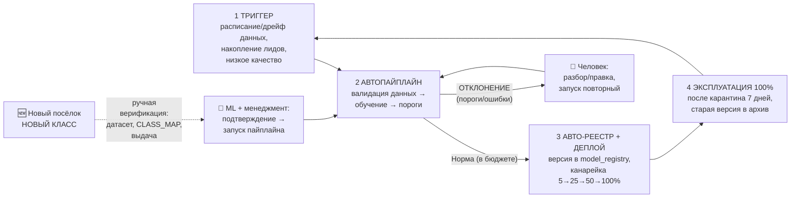
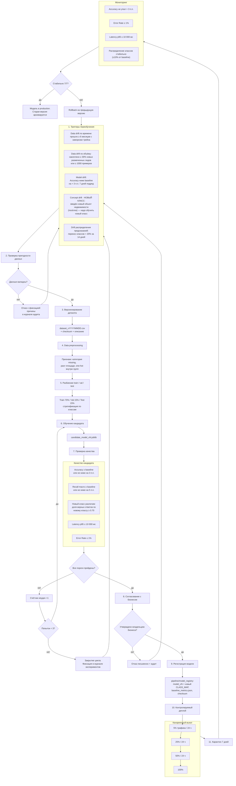

# BPMN-схема автоматического переобучения модели

**Важно:** переобучение запускается в первую очередь при появлении **нового
класса** — т.е. вводится новый объект недвижимости (посёлок), которого не было
в обучении. Пока класс не добавлен в `CLASS_MAP` и модель не переобучена,
новый посёлок моделью не предсказывается и в выдачу не попадает.

> **Принцип автоматизации (действует во всех md проекта):** штатное
> переобучение — это **автоматический пайплайн с контролем**
> (`backend/pipeline/model_update/`): сбор данных → валидация порогов →
> обучение кандидата → проверка рядом с baseline → регистрация →
> канареечный деплой. Человек подключается только в двух случаях:
> 1) **большие отклонения** — провал контрольных ворот (3 неуспешные
>    попытки подряд, деградация после деплоя, критичный дрейф);
> 2) **новый класс (новый посёлок)** — обязательная ручная верификация
>    процесса: качества нового датасета, нового `CLASS_MAP`, метаданных и
>    корректной выдачи до запуска/финализации авто-пайплайна.

## 0. Вариант 2 — для менеджмента (горизонтально, крупными мазками)

## 1. Цель документа

Описание процесса автоматического переобучения модели `global_best_model`
(классификатор посёлка для каталога видеообъектов) — от срабатывания триггера
до деплоя новой версии в production. Процесс включает обработку **data drift**,
**model drift** и **concept drift**, а также чёткие числовые пороги и действия
при неуспешных проверках.

---

## 2. BPMN-диаграмма процесса переобучения

---

## 3. Описание этапов

### Этап 1. Триггеры переобучения

| Триггер | Тип дрейфа | Условие запуска | Проверяется |
|---|---|---|---|
| **Новый класс (новый объект недвижимости)** | Concept drift | Открылся новый посёлок/ЖК — добавляется новый класс; модель должна научиться его предсказывать | По событию от бизнеса/данных |
| **Время с последнего обучения** | Data drift | Прошло ≥ **6 месяцев** с даты заморозки текущего трейна | Ежедневно по cron |
| **Объём новых данных** | Data drift | Накоплено ≥ **30%** от текущего трейна **или** ≥ **1000** новых размеченных лидов | Еженедельно |
| **Падение качества модели** | Model drift | Accuracy ниже baseline более чем на **3 п.п.** в течение **7 дней подряд** | Каждый день по production-логам |
| **Дрейф распределения предсказаний** | Data/model drift | Перекос по классам более чем на **20%** за последние **14 дней** | Ежедневно по метрикам |

**Результат:** один или несколько триггеров формируют задачу на переобучение
(`retrain_request.json` с указанием причины).

### Этап 2. Проверка пригодности данных

**Что происходит** (`pipeline/model_update/dataset_validation.py`):
- Проверка доступности источников (S3, CRM, анкеты).
- Проверка на пустые файлы, дубликаты, битые значения.
- Проверка обязательных колонок: все признаки + `target`.
- Проверка распределения классов: ни один посёлок не должен занимать
  > **80%** выборки. Для нового класса — наличие размеченных примеров.

**Порог отказа:**
- Пропущено > **10%** обязательных полей.
- Дубликатов > **5%**.
- Соединение с источником недоступно > **30 мин**.

**Результат:**
- Если данные не валидны → **письменный отказ** в журнал аудита с причиной.
- Если валидны → переход к версионированию.

### Этап 3. Версионирование датасета

**Что происходит:** датасет сохраняется как `dataset_vYYYYMMDD.csv`; фиксируются
дата сборки, объём, распределение классов, checksum, версия конвейера.

**Результат:** зафиксированный и неизменяемый датасет для обучения.

### Этап 4. Data preprocessing

**Что происходит** (`pipeline/data_preprocessing.py` + `feature_generation.py`):
- Пропуски кодируются категорией `missing` внутри группы.
- Площадь переводится в порядковый ранг `ord__ранг_площади`.
- One-hot внутри групп признаков (`bin_num__*`, `few_cat__*`).
- Список колонок сверяется с `backend/data/feature_names.txt`;
  для нового класса — обновление `feature_names` при изменении схемы анкеты.

**Результат:** матрица признаков и целевой вектор.

### Этап 5. Разбиение train / val / test

**Пропорции:** Train — **70%**, Validation — **15%**, Test — **15%**;
стратификация по классам посёлков; фиксированный `random_state=42`.

**Результат:** три выборки с сохранёнными индексами.

### Этап 6. Обучение кандидата

**Что происходит** (`pipeline/model_update/training.py`):
- Обучение XGBoost на train с валидацией на val.
- Подбор гиперпараметров по сетке: `max_depth`, `learning_rate`,
  `n_estimators`, `subsample`, `colsample_bytree`.
- Обучение **3 кандидатов** с разными сидами для оценки стабильности.
- При новом классе — контроль разделимости нового класса (нет путаницы
  с остальными посёлками).

**Результат:** файл `candidate_model_vN.joblib` + метрики на val/test.

### Этап 7. Проверка качества

| Проверка | Порог | Baseline |
|---|---|---|
| Accuracy | ≥ baseline **или** не ниже на **3 п.п.** | хранится в `model/baseline_metrics.json` |
| Recall macro | ≥ baseline **или** не ниже на **5 п.п.** | там же |
| Новый класс различим | ≥ **0.70** верных по новому классу | — |
| Latency p95 | ≤ **10 000 мс** | — |
| Error Rate | ≤ **1%** | — |

**Если проверки не пройдены:**
- Счётчик неудач +1; если неудач < **3** → возврат к обучению.
- Если неудач ≥ **3** → цикл закрывается, результаты фиксируются в журнале
  экспериментов. Новый запуск — только при новом триггере.

**Результат:** кандидат, прошедший все проверки качества.

### Этап 8. Согласование с бизнесом

Штатно этап **автоматический**: пайплайн формирует отчёт и, при прохождении
всех порогов, сам регистрирует версию. Человек включается только в режиме
«больших отклонений»:

- Отчёт: метрики кандидата vs baseline, влияние нового класса на остальные
  классы, риски.
- Требуется **письменное утверждение** владельцем бизнеса (human-in-the-loop).
- Отказ фиксируется письменно в аудит-журнале; цикл закрывается до нового
  триггера.

**Резюме:** нормальный путь — авто; человек — только владелец решения при
отклонениях (и при новом классе, где верификация ручная по определению).

**Результат:** разрешение на деплой.

### Этап 9. Регистрация модели

**Что происходит** (`pipeline/model_registry.py` + `promotion.py`):
- Кандидат копируется в `model/versions/model_vN.joblib`.
- Определяется новый `CLASS_MAP` (класс → посёлок), обновляется
  `feature_names.txt`, если менялась схема анкеты.
- Обновляется `model/baseline_metrics.json` (новый baseline).

**Результат:** зарегистрированная версия, готовая к деплою.

### Этап 10. Контролируемый деплой

**Стратегия:** канареечный выкат 5% → 25% → 50% → 100%, по **24 часа** на шаг.
Условие перехода: Error Rate ≤ **1%**, Latency p95 ≤ **10 000 мс**, нет роста
жалоб. Иначе — мгновенный rollback.

### Этап 11. Карантин 7 дней

**Что мониторится:** Accuracy не падает более чем на **3 п.п.**, Error Rate ≤
**1%**, Latency p95 ≤ **10 000 мс**, распределение предсказанных классов
стабильно (± **10%**).

- Стабильно **7/7 дней** → модель официально в production; предыдущая версия
  архивирована (для откката).
- Не пройдено → автоматический rollback + инцидент + новый триггер.

---

## 4. Типы дрейфа и реакция на них

### 4.1. Concept drift — НОВЫЙ ОБЪЕКТ НЕДВИЖИМОСТИ (главный триггер)

**Признаки:** открытие нового посёлка/ЖК; появление нового значения анкеты;
изменение стратегии маркетинга или целевой аудитории.

**Реакция:**
- Нельзя «дообучить» старую модель поверх старого набора классов:
  расширяется `CLASS_MAP` (новый класс), собираются размеченные примеры
  нового посёлка, обновляется feature-space, обучается модель с новым
  числом классов.
- Обязательно **ручные верификации** процесса: проверяются новый датасет
  (разметка, объём), новый `CLASS_MAP`/feature-space, контрольная выдача
  (анкета «под новый посёлок» → верный класс) — до запуска штатного
  авто-пайплайна.
- До завершения цикла (≥ **0.70** верных по новому классу и бизнес-одобрение)
  новый посёлок в выдаче не появляется.

### 4.2. Data drift

**Признаки:**
- Прошло ≥ **6 месяцев** с последнего обучения.
- Новых размеченных данных ≥ **30%** от трейна или ≥ **1000** примеров.
- Изменилось распределение отдельных признаков > **20%** (PSI > 0.2).

**Реакция:** запуск стандартного контура переобучения.

### 4.3. Model drift

**Признаки:**
- Accuracy ниже baseline на > **3 п.п.** **7 дней подряд**.
- Перекос распределения предсказаний > **20%** за **14 дней**.
- Рост Error Rate > **1%** или Latency p95 > **10 000 мс**.

**Реакция:**
- Первичный анализ: не инфраструктурная ли это проблема (S3, сеть).
- Если проблема в модели — запуск переобучения на свежих данных.
- Если данные не накопились — ручной разбор ML-инженером.

---

## 5. Числовые пороги — сводка

| Параметр | Значение |
|---|---|
| Максимальный срок без переобучения | **6 месяцев** |
| Минимальный объём новых данных | **30%** от трейна **или** **1000** примеров |
| Критическое падение Accuracy | более **3 п.п.** от baseline |
| Период подтверждения падения качества | **7 дней подряд** |
| Лимит перекоса распределения предсказаний | **20%** за **14 дней** |
| Максимальная доля пропусков в новых данных | **10%** |
| Максимальная доля дубликатов | **5%** |
| Максимальная доля одного класса | **80%** |
| Минимальная точность по новому классу | **0.70** |
| Максимальное число неудачных попыток обучения | **3** |
| Длительность карантина | **7 дней** |
| Длительность каждого этапа канареечного деплоя | **24 часа** |
| Допустимый Error Rate | ≤ **1%** |
| Допустимый Latency p95 | ≤ **10 000 мс** |

---

## 6. Роли и ответственность

| Роль | Зона ответственности |
|---|---|
| **ML-инженер** | Запуск контура, обучение, оценка метрик, деплой, мониторинг |
| **Data Engineer** | Сбор, валидация и версионирование данных |
| **MLOps / DevOps** | Инфраструктура, реестр моделей, канареечный деплой, rollback |
| **Владелец бизнеса** | Согласование замены модели, финальное решение |
| **Аудитор / журнал** | Сохранение отказов, версий датасетов, моделей и причин |

## 7. Артефакты процесса

| Артефакт | Назначение |
|---|---|
| `retrain_request.json` | Причина и тип триггера (в т.ч. новый класс) |
| `dataset_vYYYYMMDD.csv` | Зафиксированный датасет |
| `candidate_model_vN.joblib` | Обученная модель-кандидат |
| `model/baseline_metrics.json` | Baseline-метрики текущей production-версии |
| `model/versions/model_vN.joblib` | Реестр версий (pipeline.model_registry) |
| `business_approval_vN.pdf` | Письменное утверждение бизнеса |
| `deployment_log_vN.csv` | Лог канареечного деплоя |
| `incident_vN.md` | Описание отказа/rollback |
