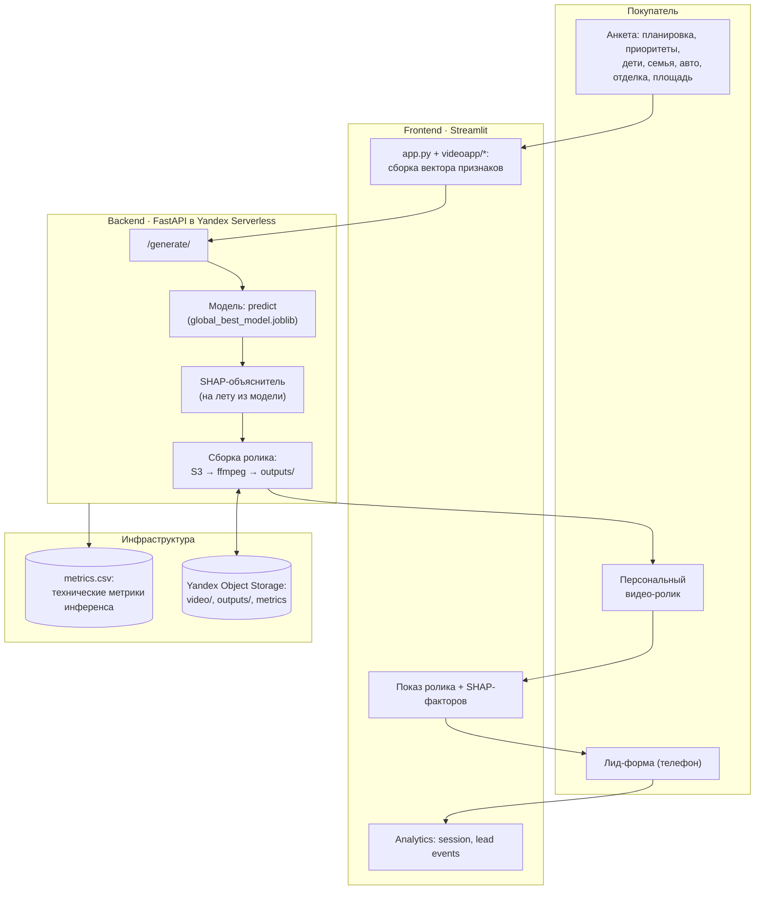
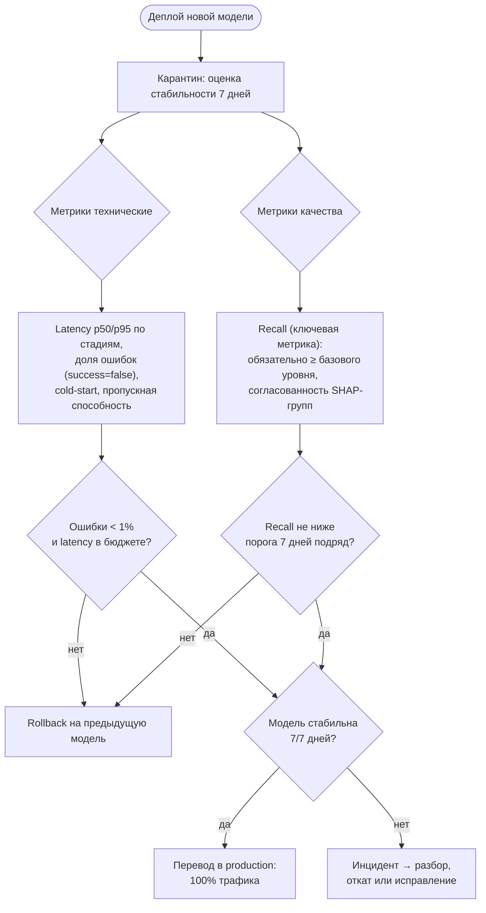
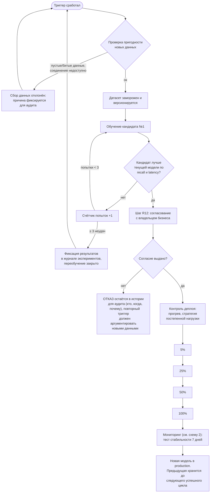

# Жизненный цикл ML-модели: эксплуатация, мониторинг, переобучение

Диаграммы для сервиса персонального видео (`video_app_a_production`).
Модель: классификатор посёлка (`global_best_model.joblib`, xgboost/сп랭),
объяснимость — SHAP, инференс — в Yandex Serverless Container.

## 1. Место модели в процессе и диаграмма эксплуатации

Покупатель отвечает на анкету → вектор признаков → модель выбирает посёлок →
SHAP объясняет «почему» → собирается персональный видео-ролик.

**Ключевые SLA эксплуатации:** cold-start (загрузка модели) измеряется в
`MODEL_LOAD_MS`, тайминги стадий `preprocess/predict model_load` возвращаются
в ответе и рендерятся на фронте; `/health` проверяет живость + наличие моделей.

## 2. Мониторинг после деплоя

## 3. Триггеры переобучения

| Триггер | Пример для этого проекта |
|---|---|
| Дрейф данных (новый вид данных) | Открылась продажа в новом посёлке/новых категорий фич, появились новые значения анкеты |
| Дрейф данных (по времени) | Прошло более 6 месяцев с последнего обучения |
| Запрос от бизнеса | Маркетинг изменил приоритетные сегменты покупателей |
| Накоплено много новых данных | Достаточно новых размеченных лидов (см. порог ниже) |
| Плановое переобучение | Регулярный квартальный цикл |

Порог данных для переобучения: как минимум столько же свежих примеров,
сколько в текущем трейне, ИЛИ ≥ 30% объёма трейна, если модель начала
проседать по recall. Переобучение только на «старых» данных запрещено.

## 4. Диаграмма переобучения (полный контур с отказами)

Правила контура:

1. **Отказ всегда письменный и остаётся в аудит-журнале.** Окончательное
   решение о замене модели принимает владелец бизнеса (техкоманда только
   рекомендует).
2. **Счётчик попыток обучения** фиксируется; более 3 неудачных кандидатов
   закрывают цикл до нового триггера.
3. **Контроль деплоя** — постепенный перевод трафика (канареечный), с
   мгновенной возможностью rollback.
4. **Карантин 7 дней** — модель считается «прошедшей» только если recall и
   технические метрики стабильны весь срок.
5. Данные для обучения проходят **валидацию пригодности**: проверка на
   пустые значения, количество строк, работу соединения и шлюза (S3/AI-вызовы).
   Непригодные данные → отказ с фиксацией причины для аудита.

## 5. Роли в процессе

| Роль | Зона ответственности |
|---|---|
| ML-инженер | обучение, оценка метрик, деплой, мониторинг |
| Владелец бизнеса | согласование замены модели, финальное решение |
| Аудитор / журнал | сохранение отказов, версий датасетов, моделей и причин |
