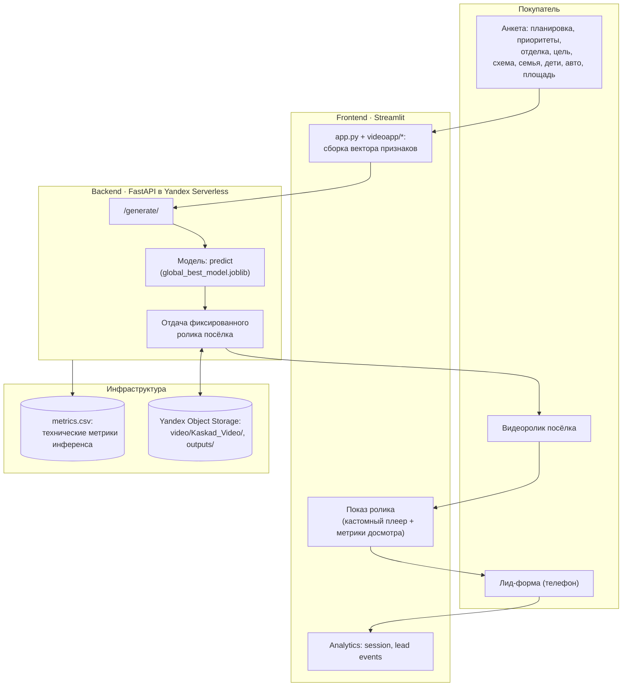
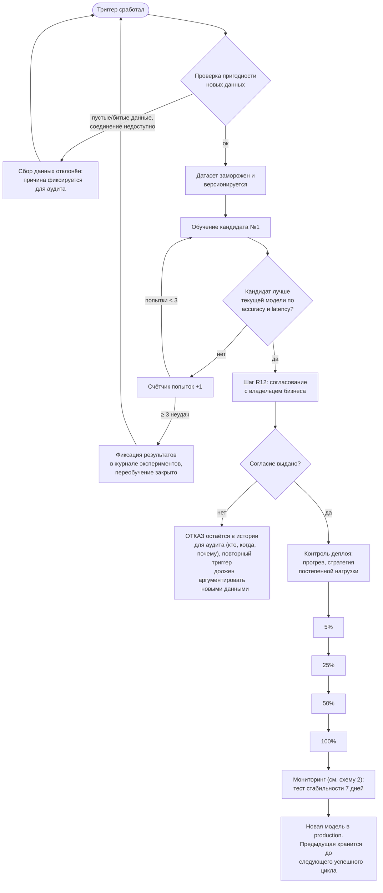

# Жизненный цикл ML-модели: эксплуатация, мониторинг, переобучение

Диаграммы для сервиса подбора посёлка (`video_app_a_production`).
Модель: классификатор посёлка (`global_best_model.joblib`, xgboost),
инференс — в Yandex Serverless Container. Ролик фиксированный по посёлку
(вариант A), переобучение — по процессу из `Model_retrain_BPMN.md`.

## 1. Место модели в процессе и диаграмма эксплуатации

Покупатель отвечает на анкету → вектор признаков → модель выбирает посёлок →
покупателю показывается готовый ролик предсказанного посёлка.



**Ключевые SLA эксплуатации:** холодный старт (загрузка модели) измеряется в
`MODEL_LOAD_MS`, тайминги стадий `preprocess/predict/model_load/total`
возвращаются в `stage_timing_ms` и рендерятся на фронте; `/health` проверяет
живость + наличие модели.

## 2. Мониторинг после деплоя

```mermaid
flowchart TB
    D(["Деплой новой модели"]) --> W7["Карантин: оценка стабильности 7 дней"]
    W7 --> M1{Метрики технические}
    W7 ruth --> M2{Метрики качества}

    M1 --> MT["Latency p50/p95 по стадиям,
    доля ошибок (success=false),
    cold-start, пропускная способность"]
    M2 --> MQ["Accuracy (ключевая метрика):
    не ниже baseline на 3 п.п.,
    стабильность распределения классов"]

    MT --> OK1{"Ошибки < 1%
    и latency в бюджете?"}
    MQ --> OK2{"Accuracy не ниже порога
    7 дней подряд?"}

    OK1 -- нет --> ROLL["Rollback на предыдущую модель"]
    OK2 -- нет --> ROLL
    OK1 -- да --> STAB{"Модель стабильна 7/7 дней?"}
    OK2 -- да --> STAB
    STAB -- да --> PROD["Перевод в production:
    100% трафика"]
    STAB -- нет --> INC["Инцидент → разбор,
    откат или исправление"]
```

## 3. Триггеры переобучения

| Триггер | Пример для этого проекта |
|---|---|
| **Новый класс (новый объект недвижимости)** | Открылась продажа в новом посёлке — модель не может предсказать класс, которого не было в обучении; требуется переобучение с новым CLASS_MAP |
| Дрейф данных (новый вид данных) | Появились новые значения анкеты / категории фич |
| Дрейф данных (по времени) | Прошло более 6 месяцев с последнего обучения |
| Запрос от бизнеса | Маркетинг изменил приоритетные сегменты покупателей |
| Накоплено много новых данных | Достаточно новых размеченных лидов (см. порог ниже) |
| Плановое переобучение | Регулярный квартальный цикл |

Порог данных для переобучения: как минимум столько же свежих примеров,
сколько в текущем трейне, ИЛИ ≥ 30% объёма трейна, если модель начала
проседать по accuracy. Переобучение только на «старых» данных запрещено.

## 4. Диаграмма переобучения (полный контур с отказами)



Правила контура:

1. **Отказ всегда письменный и остаётся в аудит-журнале.** Окончательное
   решение о замене модели принимает владелец бизнеса (техкоманда только
   рекомендует).
2. **Счётчик попыток обучения** фиксируется; более 3 неудачных кандидатов
   закрывают цикл до нового триггера.
3. **Контроль деплоя** — постепенный перевод трафика (канареечный), с
   мгновенной возможностью rollback.
4. **Карантин 7 дней** — модель считается «прошедшей» только если accuracy и
   технические метрики стабильны весь срок.
5. Данные для обучения проходят **валидацию пригодности**: проверка на
   пустые значения, количество строк, работу соединения и шлюза (S3/AI-вызовы).
   Непригодные данные → отказ с фиксацией причины для аудита.

## 5. Роли в процессе

| Роль | Зона ответственности |
|---|---|
| ML-инженер | обучение, оценка метрик, деплой, мониторинг |
| Владелец бизнеса | согласование замены модели, финальное решение |
| Аудитор / журнал | сохранение отказов, версий датасетов, моделей и причин |
